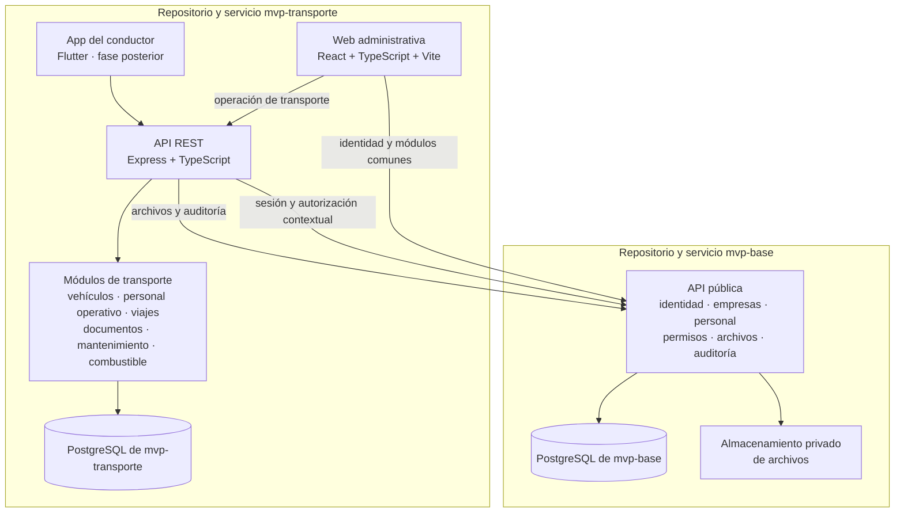

# Arquitectura

## Propósito

Describe los límites entre mvp-transporte y mvp-base, las aplicaciones y los módulos. mvp-transporte implementa sus dominios como monolito modular; mvp-base mantiene la fuente oficial de administración y configuración.

## Vista de componentes

`mvp-base` y `mvp-transporte` son aplicaciones independientes que se integran por HTTP. El submódulo fija el código de mvp-base para revisión y desarrollo local; no convierte a mvp-base en workspace npm ni habilita imports de sus rutas internas. Cada API conserva su propia base PostgreSQL y su historial de migraciones. mvp-base es dueño del esquema de plataforma; mvp-transporte es dueño de sus modelos operativos.

## Límites de dominio

- mvp-base administra identidad, autenticación, empresas, sucursales, personal, permisos, configuración, archivos, auditoría, notificaciones y catálogos, con su propia base de datos.
- mvp-transporte administra vehículos, perfiles operativos, viajes, tripulación, documentación de transporte, mantenimiento y combustible.
- Transporte solicita operaciones de plataforma mediante interfaces HTTP públicas. No importa código privado ni consulta directamente tablas de mvp-base.
- Las referencias a organización, empresa, sucursal, empleado y archivo almacenan IDs emitidos por mvp-base. La API de Transporte valida cada relación mediante contratos autorizados; los IDs recibidos del cliente nunca son prueba de pertenencia.
- Los modelos y migraciones de Transporte residen en su propia base. No se mantiene una segunda historia Prisma contra la base de mvp-base.

## Aislamiento multiempresa

1. mvp-base autentica al usuario y selecciona una organización. La sesión no selecciona una empresa activa.
2. La API de Transporte carga el recurso desde su propia base, deriva su empresa y sucursal y llama a `POST /api/v1/integrations/transport/authorize` en cada operación.
3. El `companyId` enviado por el navegador solo puede seleccionar un objetivo para crear/listar; mvp-base valida organización, empresa, sucursal y permiso, y la API usa el alcance devuelto por Base.
4. Cada lectura, escritura y relación filtra por organización/empresa y comprueba los IDs relacionados mediante el contrato de plataforma.
5. Los índices únicos de negocio, como la placa, se definen dentro de la base de Transporte y el alcance empresarial.

El contrato integrado de mvp-base (`97c5840`) valida sesiones, membresías y permisos `transport.*` por alcance. La API de Transporte no debe interpretar `/auth/me` como fuente de permisos autorizados ni verificar localmente el Bearer.

## Organización del código

- `apps/api`: API propia de Transporte, composición Express y módulos de transporte.
- `apps/web`: navegación y pantallas web de Transporte.
- `packages/shared-contracts`: contratos propios de Transporte realmente compartidos entre API y web.
- `mvp-base/`: submódulo Git fijado a `97c5840`; conserva su workspace, API y base independientes.
- `docs/`: especificación funcional, decisiones, modelo de datos y tareas.

Los workspaces de `apps/api`, `apps/web` y `packages/shared-contracts` pertenecen a Transporte. Los scripts de raíz ejecutan sus comandos y los de mvp-base por separado. El submódulo conserva su workspace, dependencias, API y migraciones.

## Contratos entre módulos

- Personal expone empleados por API; Transporte valida el empleado y guarda solo su ID externo en los perfiles de conductor/ayudante.
- Archivos externos de vehículos se gestionan mediante el contrato de Base; no se crea almacenamiento paralelo.
- Auditoría de Transporte se registra en Base con el Bearer del actor y el alcance derivado de la solicitud autorizada.
- La API registra sus permisos `transport.*` en Base y solicita autorización contextual por organización, empresa y sucursal.
- Viajes podrá enlazarse con una planificación de distribución cuando su modelo esté definido; no se crea ahora un módulo de rutas permanentes.

Los límites, APIs revisadas y brechas están detallados en [docs/integration/mvp-base.md](integration/mvp-base.md).
