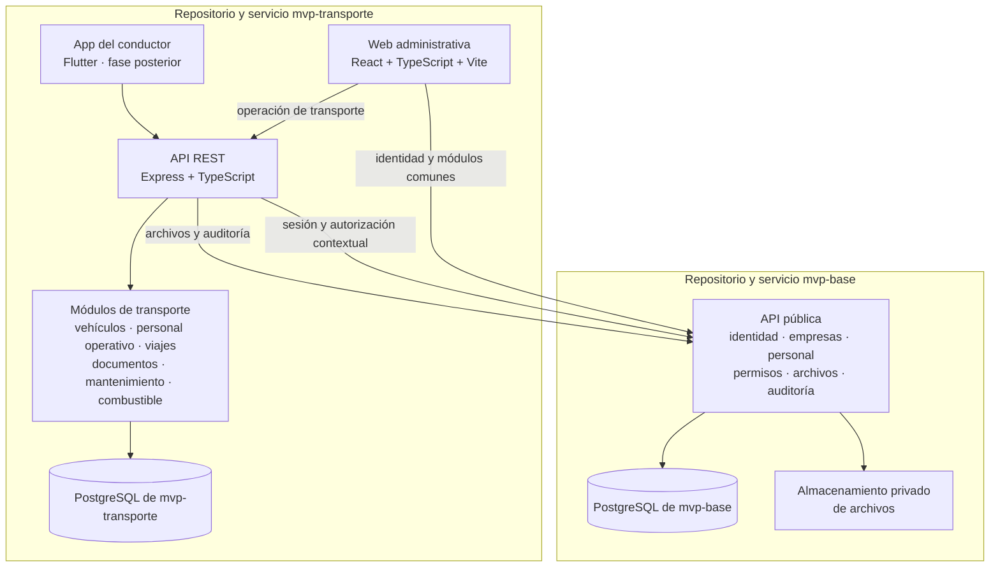

# Arquitectura

## Propósito

Describe los límites entre mvp-transporte y mvp-base, las aplicaciones y los módulos. mvp-transporte implementa sus dominios como monolito modular; mvp-base mantiene la fuente oficial de administración y configuración.

## Vista de componentes

`mvp-base` y `mvp-transporte` son aplicaciones independientes que se integran por HTTP. El submódulo fija el código de mvp-base para revisión y desarrollo local; no convierte a mvp-base en workspace npm ni habilita imports de sus rutas internas. Cada API conserva su propia base PostgreSQL y su historial de migraciones. mvp-base es dueño del esquema de plataforma; mvp-transporte es dueño de sus modelos operativos.

## Límites de dominio

- mvp-base administra identidad, autenticación, empresas, sucursales, personal, permisos, configuración, archivos, auditoría, notificaciones y catálogos, con su propia base de datos.
- mvp-transporte administra vehículos, perfiles operativos, viajes, tripulación, documentación de transporte, mantenimiento y combustible.
- Transporte solicita operaciones de plataforma mediante interfaces HTTP públicas. No importa código privado ni consulta directamente tablas de mvp-base.
- Las referencias a organización, empresa, sucursal, empleado y archivo almacenan IDs emitidos por mvp-base. La API de Transporte valida cada relación mediante contratos autorizados; los IDs recibidos del cliente nunca son prueba de pertenencia.
- Los modelos y migraciones de Transporte residen en su propia base. No se mantiene una segunda historia Prisma contra la base de mvp-base.

## Aislamiento multiempresa

1. mvp-base autentica al usuario y selecciona una organización. En la revisión fijada no existe una empresa activa seleccionada en sesión.
2. La API de Transporte valida la sesión y el alcance del actor con una interfaz pública de mvp-base antes de leer o escribir recursos.
3. El `companyId` de una solicitud identifica el recurso objetivo; mvp-base debe validar organización, empresa, sucursal y permiso para ese objetivo. El valor nunca se usa por sí solo para autorizar.
4. Cada lectura, escritura y relación filtra por organización/empresa y comprueba los IDs relacionados mediante el contrato de plataforma.
5. Los índices únicos de negocio, como la placa, se definen dentro de la base de Transporte y el alcance empresarial.

El contrato actual de mvp-base no devuelve alcances de permiso en `/auth/me` ni ofrece permisos `transport.*`. TASK-007 registra la extensión necesaria. Hasta que se implemente, no se deben abrir endpoints de escritura de Transporte.

## Organización del código

- `apps/api`: API propia de Transporte, composición Express y módulos de transporte.
- `apps/web`: navegación y pantallas web de Transporte.
- `packages/shared-contracts`: contratos propios de Transporte realmente compartidos entre API y web.
- `mvp-base/`: submódulo Git en la revisión registrada en ADR-002; conserva su workspace, API y base independientes.
- `docs/`: especificación funcional, decisiones, modelo de datos y tareas.

Los scripts de raíz delegan en los comandos existentes de mvp-base mientras Transporte no tenga aplicaciones propias. No forman un workspace combinado.

## Contratos entre módulos

- Personal expone una referencia estable al empleado; Transporte añade perfiles de conductor y ayudante sin duplicar la identidad.
- Archivos debe recibir y devolver referencias autorizadas para recursos de transporte; la revisión fijada aún no contempla vehículos como tipo de recurso.
- Auditoría debe registrar actor, empresa, acción y recurso para cambios sensibles; la revisión fijada solo expone lectura de auditoría y escritura interna.
- El módulo de permisos debe validar códigos `transport.*` por organización, empresa y sucursal. La revisión fijada devuelve códigos planos y no define dichos permisos.
- Viajes podrá enlazarse con una planificación de distribución cuando su modelo esté definido; no se crea ahora un módulo de rutas permanentes.

Los límites, APIs revisadas y brechas están detallados en [docs/integration/mvp-base.md](integration/mvp-base.md).
