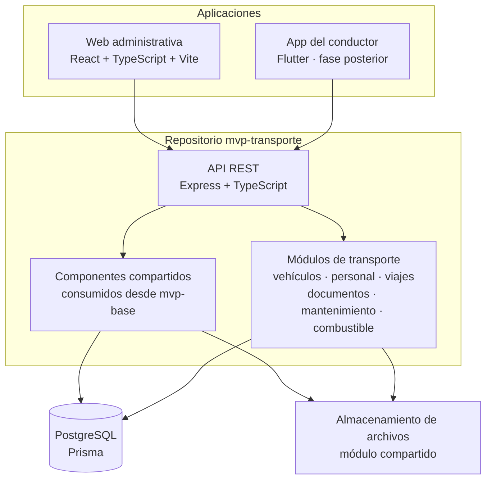

# Arquitectura

## Propósito

Describe los límites entre mvp-transporte y mvp-base, las aplicaciones y los módulos. mvp-transporte es un monolito modular; mvp-base conserva el código fuente oficial de administración y configuración.

## Vista de componentes

Los componentes de plataforma se integran como paquetes versionados si existen. Si mvp-base todavía no ofrece paquetes importables, el repositorio se puede fijar como submódulo mientras se define una integración gradual. En ambos casos, el código base tiene una única fuente oficial: mvp-base.

## Límites de dominio

- mvp-base administra identidad, autenticación, empresas, sucursales, personal, permisos, configuración, archivos, auditoría, notificaciones y catálogos.
- mvp-transporte administra vehículos, perfiles operativos, viajes, tripulación, documentación de transporte, mantenimiento y combustible.
- Transporte solicita operaciones de plataforma mediante sus interfaces públicas. No modifica directamente tablas o reglas internas de mvp-base sin una integración documentada.
- El esquema efectivo de datos debe conservar los modelos compartidos y añadir los modelos de transporte con migraciones compatibles.

## Aislamiento multiempresa

1. La sesión identifica al usuario y la empresa seleccionada.
2. La API valida que el usuario pertenece a esa empresa y que posee el permiso requerido.
3. Los casos de uso reciben el contexto de empresa desde middleware confiable; no aceptan companyId como autoridad desde el cuerpo del cliente.
4. Cada lectura, escritura y relación verifica que los recursos pertenezcan a la empresa activa.
5. Los índices únicos de negocio, como la placa, se definen dentro del alcance empresarial.

## Organización del código

- apps/api: composición Express, middleware compartido e integración de módulos de transporte.
- apps/web: navegación y pantallas web de transporte.
- packages/shared-contracts: contratos propios de mvp-transporte realmente compartidos entre API y web.
- mvp-base/: submódulo Git en la revisión registrada en ADR-002; permanece como workspace independiente y no se incorpora al workspace npm de mvp-transporte.
- docs/: especificación funcional, decisiones, modelo de datos y tareas.

El submódulo no debe asumirse automáticamente como workspace npm. Primero se inspeccionan las dependencias, exports, scripts y estrategia Prisma de mvp-base.

## Contratos entre módulos

- Personal expone una referencia estable al empleado; transporte añade perfiles de conductor y ayudante sin duplicar la identidad.
- Archivos recibe y devuelve referencias de archivo autorizadas; transporte conserva metadatos documentales.
- Auditoría registra actor, empresa, acción y recurso para cambios sensibles.
- El módulo de permisos provee permisos por empresa. Los nombres concretos se adaptan a la convención de mvp-base.
- Viajes podrá enlazarse con una planificación de distribución cuando su modelo esté definido; no se crea ahora un módulo de rutas permanentes.
