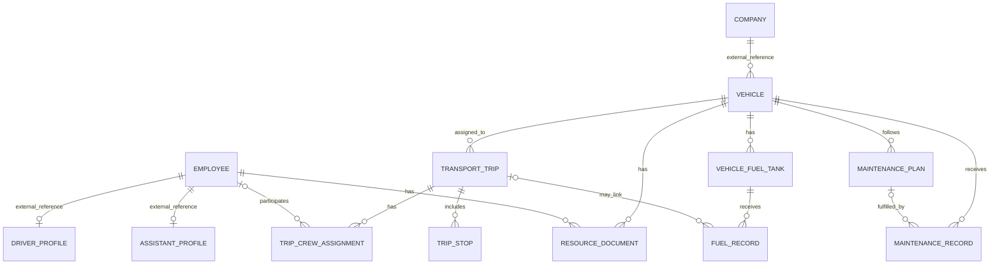

# Modelo de datos

## Propósito y estado

Este documento define el modelo conceptual inicial. Los nombres son sugeridos; antes de crear migraciones deben contrastarse con los nombres, IDs, tenant model y estrategia Prisma de mvp-base.

## Entidades de mvp-base reutilizadas

No volver a crear estas entidades en mvp-transporte:

- Company y Branch.
- User, membership y roles/permisos.
- Employee o registro general de personal.
- Archivo/StorageReference.
- AuditEvent.
- Catálogos y configuración compartida.

La relación exacta debe seguir el esquema real de mvp-base.

Estos modelos pertenecen a la base de datos de mvp-base. La base de Transporte no replica sus tablas ni mantiene claves foráneas entre bases. Los modelos de Transporte guardan IDs externos para `organizationId`, `companyId`, `branchId`, `employeeId` y `fileId`; cada relación se valida a través de los contratos autorizados de mvp-base. Hasta que estén disponibles la autorización contextual y los contratos de archivo/auditoría requeridos, no se implementan operaciones de escritura que dependan de ellos. Ver [contrato de integración](integration/mvp-base.md).

## Entidades de transporte

| Entidad | Responsabilidad | Relaciones principales |
|---|---|---|
| Vehicle | Datos y disponibilidad del vehículo | Referencias externas a empresa/sucursal; documentos, viajes, mantenimiento y tanques de Transporte |
| DriverProfile | Datos operativos del conductor | Referencia externa a Employee |
| AssistantProfile | Datos operativos del ayudante propio | Referencia externa a Employee |
| TransportTrip | Operación de transporte en una fecha o periodo | Vehicle, tripulación y paradas |
| TripCrewAssignment | Rol, origen e intervalo de participación de la tripulación | TransportTrip y opcionalmente Employee |
| TripStop | Parada propia de un viaje corto | TransportTrip |
| ResourceDocument | Tipo, archivo y vencimiento de documento | Vehicle o Employee, exactamente uno; el archivo es una referencia externa autorizada |
| MaintenancePlan | Regla preventiva y próximo vencimiento | Vehicle |
| MaintenanceRecord | Mantenimiento correctivo o servicio realizado | Vehicle y opcionalmente MaintenancePlan |
| VehicleFuelTank | Tanque instalado y combustible/unidad admitidos | Vehicle |
| FuelRecord | Carga de combustible y medición | VehicleFuelTank y opcionalmente TransportTrip |

## Relaciones principales

El diagrama muestra relaciones conceptuales. ResourceDocument debe referenciar vehículo o empleado, pero no ambos. TripCrewAssignment puede referenciar un empleado interno o guardar un ayudante externo del cliente.

## Reglas de integridad

### Empresa

- Cada recurso operativo almacena organización y empresa como referencias externas.
- Las relaciones locales entre vehículo, viaje, documento, mantenimiento, tanque y carga se validan en la base de Transporte.
- Las relaciones con empresa, sucursal, empleado y archivo se validan por los contratos de mvp-base; no hay claves foráneas entre bases.
- Las consultas se filtran por empresa objetivo y organización validadas en backend. mvp-base actualmente selecciona organización, no empresa activa.
- La placa es única por empresa, incluyendo recursos desactivados que mantengan historial.

### Personal y tripulación

- Los perfiles de conductor y ayudante se asocian al Employee existente.
- Una persona puede tener ambos perfiles.
- Una asignación interna requiere un empleado activo con perfil compatible con su rol.
- Un ayudante del cliente se representa con origen CLIENTE, Employee nulo y nombre externo opcional.
- Cada viaje de distribución registra de uno a dos ayudantes totales entre internos y externos.
- La ruta corta no asigna ayudantes en el flujo inicial.
- Los viajes largos admiten ayudantes si el servicio los requiere.
- Los relevos de conductor usan intervalos de participación sin superposición para el mismo conductor.

### Viajes

- Un viaje tiene un tipo: DISTRIBUTION, SHORT o LONG.
- Un viaje usa un vehículo en la primera versión.
- Debe conservar fechas previstas y reales, estado e historial de cambios.
- Un viaje LONG puede durar varios días, registrar contratante y precinto, y tener varios conductores en intervalos sucesivos.
- SHORT admite una o dos paradas simples, sin crear catálogo de rutas.
- Las asignaciones no deben superponer el uso del vehículo ni la participación de empleados internos.
- La validación de concurrencia debe ejecutarse transaccionalmente; considerar restricciones PostgreSQL cuando encajen con el esquema existente.

### Documentos

- Cada documento pertenece exactamente a un vehículo o empleado.
- Referencia un archivo del servicio de mvp-base.
- Fecha de emisión, vencimiento y renovación pueden ser opcionales según el tipo de documento.
- Las reglas de notificación quedan para una fase posterior.

### Mantenimiento

- MaintenanceRecord clasifica correctivo o preventivo y puede registrar fecha, kilometraje, costo, proveedor, archivos y periodo fuera de servicio.
- MaintenancePlan permite intervalo por kilometraje, intervalo de tiempo opcional y una ventana de fechas prevista.
- Completar un servicio enlazado al plan actualiza el próximo vencimiento conservando el historial.
- Un vehículo fuera de servicio no se asigna a un viaje nuevo.

### Combustible

- Un vehículo puede tener varios tanques y tipos de combustible.
- VehicleFuelTank define tipo, capacidad y unidad.
- FuelRecord pertenece a un tanque; guarda cantidad, unidad, precio unitario, importe total, fecha, kilometraje, proveedor y comprobante.
- Volúmenes de gasolina y GNV se reportan por separado. Los importes monetarios pueden sumarse en la moneda configurada.
- El kilometraje no puede disminuir sin una corrección explícita auditada.

## Evolución futura

La planificación de distribución podrá vincularse con TransportTrip mediante una referencia acordada cuando exista su modelo. No crear ahora entidades de rutas, horarios, propietarios o flota.
