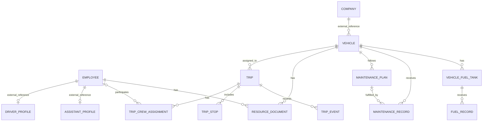

# Modelo de datos

## Propósito y estado

Este documento combina el modelo conceptual del producto con los modelos implementados por TASK-002, TASK-003 y TASK-004.

## Entidades de mvp-base reutilizadas

No volver a crear estas entidades en mvp-transporte:

- Company y Branch.
- User, membership y roles/permisos.
- Employee o registro general de personal.
- Archivo/StorageReference.
- AuditEvent.
- Catálogos y configuración compartida.

La relación exacta debe seguir el esquema real de mvp-base.

Estos modelos pertenecen a la base de datos de mvp-base. La base de Transporte no replica sus tablas ni mantiene claves foráneas entre bases. Los modelos de Transporte guardan IDs externos para `organizationId`, `companyId`, `branchId`, `employeeId` y `fileId`; cada relación se valida a través de los contratos autorizados de mvp-base, integrados en `97c5840`. Ver [contrato de integración](integration/mvp-base.md).

## Entidades de transporte

| Entidad | Responsabilidad | Relaciones principales |
|---|---|---|
| Vehicle | Identidad, capacidad y estado administrativo del vehículo | Referencias externas a organización/empresa/sucursal; documentos, viajes, mantenimiento y tanques de Transporte |
| DriverProfile | Datos operativos del conductor | Referencia externa a Employee |
| AssistantProfile | Datos operativos del ayudante propio | Referencia externa a Employee |
| Trip | Operación de transporte en una fecha o periodo | Vehicle, tripulación, paradas e historial |
| TripCrewAssignment | Rol, origen e intervalo de participación de la tripulación | Trip y opcionalmente Employee |
| TripStop | Parada propia de una ruta corta | Trip |
| TripEvent | Historial de creación, asignaciones y cambios de estado | Trip y actor externo de mvp-base |
| ResourceDocument | Tipo, archivo y vencimiento de documento | Vehicle o Employee, exactamente uno; el archivo es una referencia externa autorizada |
| MaintenancePlan | Regla preventiva y próximo vencimiento | Vehicle |
| MaintenanceRecord | Mantenimiento correctivo o servicio realizado | Vehicle y opcionalmente MaintenancePlan |
| VehicleFuelTank | Tanque instalado y combustible/unidad admitidos | Vehicle |
| FuelRecord | Carga de combustible y medición | VehicleFuelTank |

### Modelos implementados en TASK-002, TASK-003 y TASK-004

`Vehicle` guarda `organizationId`, `companyId`, `branchId` opcional, placa y placa normalizada, tipo, marca, modelo, año opcional, `capacityKg` decimal, `odometerKm` entero opcional, estado administrativo y marcas de tiempo. La placa normalizada es única por empresa; la capacidad debe ser mayor que cero y el odómetro no puede ser negativo ni reducirse mediante la API.

`DriverProfile` y `AssistantProfile` guardan los IDs externos de organización, empresa y empleado, estado y marcas de tiempo. Cada perfil es único por empresa y empleado; los dos perfiles usan tablas distintas, así que una persona puede tener ambos. La API comprueba en mvp-base que el empleado esté activo y pertenezca a la empresa antes de crear o reactivar.

`ResourceDocument` relaciona exactamente un vehículo local o un ID externo de empleado con un `fileId` de mvp-base, fechas opcionales y tipo. Renovar crea un registro nuevo que apunta al anterior y marca el anterior como `SUPERSEDED`; el archivo se descarga desde Base solo después de revalidar permisos. La migración de TASK-003 se aplicó en `mvp_transport_local` el 2026-11-12.

`MaintenancePlan` configura un intervalo positivo en km, días o ambos, y guarda el siguiente objetivo por km/fecha con su ventana. `MaintenanceRecord` conserva tareas programadas, en curso, completadas o canceladas; registrar el odómetro actualiza el del vehículo. `outOfService` solo puede ser verdadero durante un registro `IN_PROGRESS`.

`VehicleFuelTank` fija combustible, unidad y capacidad para un vehículo. `FuelRecord` referencia el tanque y guarda una instantánea de combustible/unidad, cantidad, costo total, moneda, fecha, proveedor y kilometraje. Una restricción de base verifica que tanque, vehículo y alcance coincidan. No se guarda precio unitario ni vínculo a viaje en esta entrega.

`Trip` guarda tipo, estado, empresa/sucursal de autorización, vehículo, origen/destino, fechas previstas/reales, empresa contratante y precintos para viaje largo, motivo de cancelación y actor creador. `TripStop` conserva una o dos paradas simples de ruta corta. `TripCrewAssignment` conserva cada intervalo interno o de cliente; al cambiar una asignación, la anterior se marca cancelada y permanece consultable. `TripEvent` registra actor, fecha y detalle de planificación, asignación, inicio, finalización y cancelación. La migración `20261112141502_task_004_trips` se aplicó en `mvp_transport_local` el 2026-11-12; `20261112170000_task_004_cancellation_reason_check` añade el requisito de motivo no vacío y está pendiente de aplicación en la base local.

## Relaciones principales

ResourceDocument debe referenciar vehículo o empleado, pero no ambos. TripCrewAssignment puede referenciar un empleado interno o guardar un ayudante externo del cliente.

## Reglas de integridad

### Empresa

- Cada recurso operativo almacena organización y empresa como referencias externas.
- Las relaciones locales entre vehículo, viaje, documento, mantenimiento, tanque y carga se validan en la base de Transporte.
- Las relaciones con empresa, sucursal, empleado y archivo se validan por los contratos de mvp-base; no hay claves foráneas entre bases.
- Las consultas se filtran por empresa objetivo y organización validadas en backend. mvp-base actualmente selecciona organización, no empresa activa.
- La placa es única por empresa, incluyendo recursos desactivados que mantengan historial.
- La capacidad de carga se guarda en kilogramos (`capacityKg`); el odómetro se guarda en kilómetros (`odometerKm`).
- El estado administrativo del vehículo es ACTIVE/INACTIVE. El bloqueo por mantenimiento se calcula a partir de un registro IN_PROGRESS con `outOfService` y se expone como `maintenanceBlocked`; TASK-004 rechaza su asignación mientras siga activo ese bloqueo.

### Personal y tripulación

- Los perfiles de conductor y ayudante se asocian al Employee existente.
- Una persona puede tener ambos perfiles.
- DriverProfile y AssistantProfile guardan `employeeId` y `companyId` externos; no duplican nombres, documentos ni contactos.
- Cada perfil valida que el empleado exista, esté activo y pertenezca a la empresa indicada mediante la API pública de mvp-base.
- Una asignación interna requiere un empleado activo con perfil compatible con su rol.
- Un ayudante del cliente se representa con origen CLIENTE, Employee nulo y nombre externo opcional.
- Cada viaje de distribución registra de uno a dos ayudantes totales entre internos y externos.
- La ruta corta no asigna ayudantes en el flujo inicial.
- Los viajes largos admiten ayudantes si el servicio los requiere.
- Los relevos de conductor usan intervalos de participación sin superposición para el mismo conductor.

### Viajes

- Un viaje tiene un tipo: DISTRIBUTION, SHORT_ROUTE o LONG_DISTANCE.
- Un viaje usa un vehículo en la primera versión.
- Debe conservar fechas previstas y reales, estado e historial de cambios.
- Un viaje LONG puede durar varios días, registrar contratante y precinto, y tener varios conductores en intervalos sucesivos.
- SHORT admite una o dos paradas simples, sin crear catálogo de rutas.
- Las asignaciones no deben superponer el uso del vehículo ni la participación de empleados internos.
- La confirmación exige cobertura continua de conductor y valida estado del vehículo, mantenimiento y documentos actuales vencidos antes del fin.
- La validación de concurrencia usa bloqueos transaccionales por vehículo y empleado antes de consultar solapamientos.

### Documentos

- Cada documento pertenece exactamente a un vehículo o empleado.
- Referencia un archivo del servicio de mvp-base.
- Fecha de emisión, vencimiento y renovación pueden ser opcionales según el tipo de documento.
- Las reglas de notificación quedan para una fase posterior.

### Mantenimiento

- MaintenanceRecord clasifica correctivo o preventivo y puede registrar fecha, kilometraje, costo, proveedor, archivos y periodo fuera de servicio.
- MaintenancePlan permite intervalo por kilometraje, intervalo de tiempo opcional y una ventana de fechas prevista.
- Completar un servicio enlazado al plan actualiza el próximo vencimiento conservando el historial.
- Un vehículo fuera de servicio no se asigna a un viaje nuevo ni se inicia un viaje asignado.

### Combustible

- Un vehículo puede tener varios tanques y tipos de combustible.
- VehicleFuelTank define tipo, capacidad y unidad.
- FuelRecord pertenece a un tanque activo del vehículo al momento de la carga; guarda cantidad, unidad, importe total, moneda, fecha, kilometraje y proveedor opcional.
- Volúmenes de gasolina y GNV se reportan por separado. Los importes monetarios pueden sumarse en la moneda configurada.
- Gasolina usa litros; GNV usa metros cúbicos o kilogramos. Los reportes se agrupan también por unidad y moneda.
- En los registros actuales el kilometraje no puede disminuir ni borrarse mediante edición normal. Una futura corrección del dato deberá usar una acción separada y auditada.

## Evolución futura

Cuando se defina el modelo de distribución diaria, podrá vincularse con `Trip` mediante una referencia acordada. No crear ahora entidades de rutas, horarios, propietarios o flota.
